# Clockpit

Digital clock and 14 animations for a **16x16 RGB NeoPixel matrix**, running on **Raspberry Pi Pico W / Pico 2 W + MicroPython**. Includes a desktop simulator.

## Desktop simulator

Requires Python 3.8+ and Tkinter. Run from the repository root:

```bash
python -m simulator.gui
```

Select an animation from the list or use **Up / Down / Mode**. Speed ranges from **0.01x to 50x** and scales animation timing and the virtual clock. Preview refreshes at about 30 FPS.

## Hardware and wiring

| Connection | GPIO | Physical Pico pin | Other connection |
| --- | --- | --- | --- |
| Mode button | GP5 | 7 | Button to GND, e.g. pin 8 |
| Up / + button | GP13 | 17 | Button to GND, e.g. pin 18 |
| Down / − button | GP9 | 12 | Button to GND, e.g. pin 13 |
| NeoPixel data, serpentine wiring | GP22 | 29 | Matrix DIN |
| Pico supply | VSYS | 39 | +5 V after the main switch |
| Common ground | GND | 28 | Supply negative and matrix GND |

The button assignments match [main.py](main.py): `plusButton = Pin(13, ...)`, `minusButton = Pin(9, ...)`, and `modeButton = Pin(5, ...)`. All three use `Pin.IN` / `Pin.PULL_UP`; pressing a button shorts its input to GND. GPIO numbers differ from physical header pin numbers. These header connections are the same on Pico W and Pico 2 W.

Two English diagrams show the same firmware connections and a main switch that powers both the Pico and matrix. Each diagram includes physical pin numbers and a connection reference.

**Standard main switch** — [SVG](docs/wiring.svg) · [PNG](docs/wiring.png)


**Illuminated four-terminal main switch** — [SVG](docs/wiring-illuminated.svg) · [PNG](docs/wiring-illuminated.png). The indicator connects between switched +5 V and GND, so it lights only when the clock is on. Terminal labels identify functions, not an assumed physical terminal order.

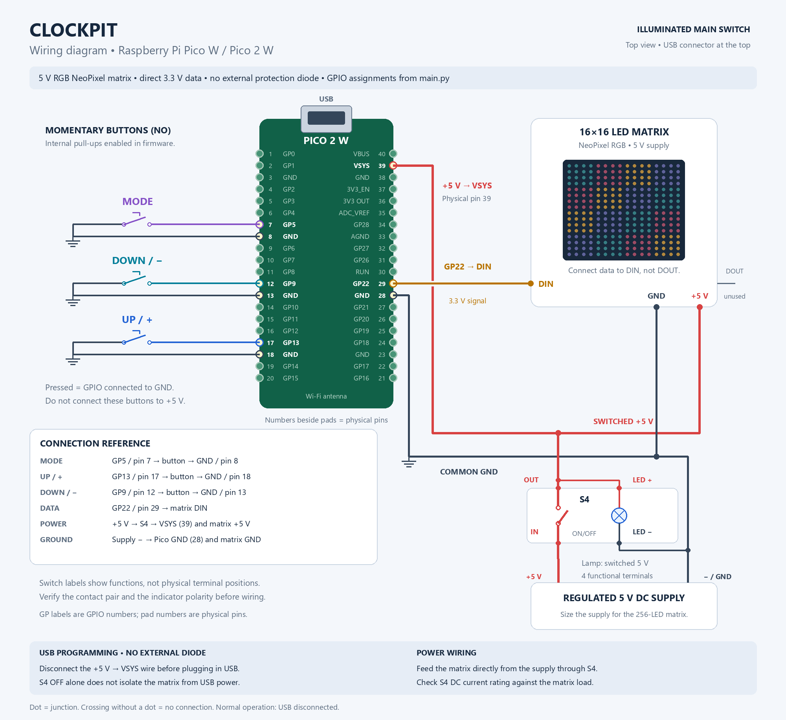

The diagrams use direct GP22-to-DIN data wiring and no external protection diode. With this supply arrangement, **disconnect the +5 V wire from VSYS before connecting powered USB**; turning the main switch off alone does not isolate the matrix from USB power. Feed the matrix directly from the supply through the switch, and verify the switch's DC current rating for the actual LED load.

See [wiring details, switch specifications and USB procedure](docs/wiring.md).

## 3D-printed enclosure


The **[v7 Bambu Studio project with a 0.20 mm front](models/enclosure/bambu/LED16x16_Pico_v7_front_0p20mm_SUNLU.3mf)** has been confirmed by a successful physical print. It contains the reinforced enclosure, Pico holder, black SUNLU PETG settings for the **P2S / standard 0.4 mm nozzle**, and the saved slicing result.

Open the `.3mf` **as a complete project** to retain its settings. [Printing and assembly details](docs/enclosure.md) describe material assignment, validation and the separate [STL files](models/enclosure/stl/). The rear cover is excluded pending physical testing.

## Pico W / Pico 2 W setup

1. Install MicroPython for your board: [Pico W](https://micropython.org/download/RPI_PICO_W/) or [Pico 2 W](https://micropython.org/download/RPI_PICO2_W/).
2. Create an ignored `secrets.py` file:

   ```python
   wifi_name = 'your_ssid'
   wifi_pass = 'your_password'
   ```

3. Copy this layout to the Pico filesystem, preserving package `__init__.py` files:

   ```text
   /main.py
   /secrets.py
   /core/          all .py files
   /animations/    all .py files
   ```

4. Reset the board. `main.py` starts automatically.

**VS Code / MicroPico:** use **Upload Project** with this repository opened as the project folder. [Project settings](.vscode/settings.json) upload only `.py` files and exclude tests, simulator, tools, docs, enclosure models and caches. `secrets.py` is uploaded but stays ignored by Git. Existing unwanted files on the board need a one-time manual cleanup; upload filters do not remove them.

Defaults: **125 MHz**, brightness **96/255**, display **16x16**. Edit display/brightness settings in [main.py](main.py). Overclocking is disabled in [core/init.py](core/init.py): `OVERCLOCK_ENABLED = False`; the optional `overclock_freq` is 250 MHz.

Startup synchronizes the RTC through NTP, then disables Wi-Fi. If synchronization fails, the application uses the current RTC. The clock displays Polish local time, including daylight saving time. Keep `simulator/`, `tests/`, `docs/` and desktop tools off the board.

## Controls

Press **Mode** to cycle through:

| Mode | Up / Down | Display |
| --- | --- | --- |
| 0 | Next / previous animation | Animation |
| 1 | Brightness + / - 4, range 0..255 | Animation + temporary percentage |
| 2 | Next / previous animation | Animation + clock overlay |

Hold Up/Down to repeat. Animation selection stops at the first/last item.

## Animations

Listed in selection order; names link to source files. GIF previews loop automatically. Clock runs at 8x speed; Day Cycle shows 24 hours in 12 seconds. Other previews are illustrative, not Pico FPS measurements.

| Module | Effect | Preview |
| --- | --- | --- |
| [Clock](animations/mod_clock.py) | Time and fading seconds border | 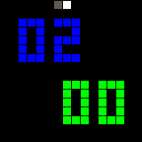 |
| [Fire Plasma](animations/mod_fireplasma.py) | Heat-map fire |  |
| [Game of Life](animations/mod_gameoflife.py) | Conway's cellular automaton | 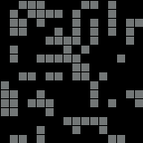 |
| [Donut](animations/mod_donut.py) | Rotating shaded 3D torus | 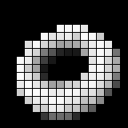 |
| [Spiral](animations/mod_spiral.py) | Drawing and erasing spiral trails |  |
| [Matrix Rain](animations/mod_matrixrain.py) | Falling green trails | 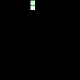 |
| [Ray Bouncer](animations/mod_raybouncer.py) | Bouncing lights and fading trails |  |
| [Color Vortex](animations/mod_vortex.py) | Rotating colour field | 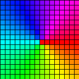 |
| [Lava](animations/mod_lava.py) | Flowing sinusoidal colours | 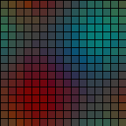 |
| [Fireplace](animations/mod_fireplace.py) | Smooth flames, embers and drifting sparks | 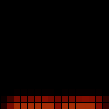 |
| [Rainbow](animations/mod_rainbow.py) | Moving colour gradients | 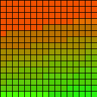 |
| [Maze](animations/mod_maze.py) | Generated maze with a moving trail | 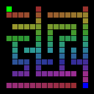 |
| [Santa Tree](animations/mod_santatree_16x16.py) | Tree with sparkling lights | 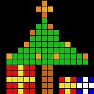 |
| [Mandelbrot](animations/mod_mandelbrot.py) | Boundary-following fractal zoom | 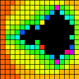 |
| [Day Cycle](animations/mod_daycycle.py) | Local-time sky, travelling sun, twilight, moon and stars | 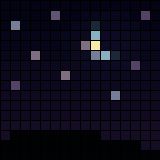 |

Day Cycle follows Polish local time. Its fixed sunrise/sunset hours default to **06:00 / 18:00**; edit `SUNRISE` / `SUNSET` in the module (seconds since midnight).

## Tests and diagnostics

```bash
python -m unittest discover -s tests -v
```

- Serial logs: firmware/reset cause, active module, CPU clock, heap, FPS and frame preparation time.
- `DEBUG_STATS = False` in `main.py` disables periodic logs; memory maintenance still runs every 30 seconds.
- Runtime exceptions save a traceback and module/stage context to `/clockpit-crash.log`.
- Optional watchdog: set `WATCHDOG_TIMEOUT_MS = 8000` in `main.py`. Default is `0` (disabled); once enabled, stopping at the REPL also triggers a reset.

[Development, animation API and profiling](docs/development.md) · [Stability audit and 8-hour Pico test](docs/stability-review.md)

License: [MIT](https://opensource.org/licenses/MIT).
