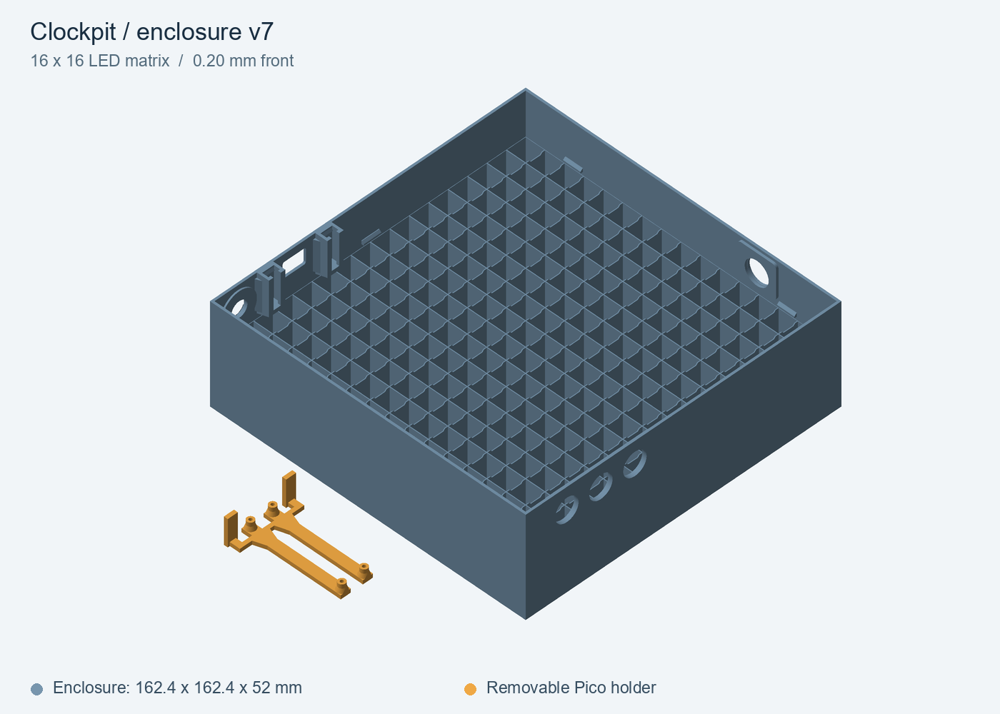

# Enclosure and Bambu Studio projects

*Rendered from the v7 STL files. The holder is highlighted in amber; both parts use black PETG in the saved Bambu project.*

The enclosure fits the Clockpit 16×16 LED matrix and a sliding Raspberry Pi Pico holder. Its external dimensions are **162.4 × 162.4 × 52 mm**. Version 7 includes the 16×16 internal grid, reinforced button apertures, reinforced Pico guides and the reinforced removable holder.

## Ready-to-print project

| Version | Complete Bambu Studio project | Front | Saved estimate, including preparation |
| --- | --- | --- | --- |
| v7 | [LED16x16_Pico_v7_front_0p20mm_SUNLU.3mf](../models/enclosure/bambu/LED16x16_Pico_v7_front_0p20mm_SUNLU.3mf) | 0.20 mm | About 5 h 54 min, 122.2 g PETG |

**v7 is the recommended, physically tested version.** Its front membrane was thickened from 0.16 to 0.20 mm after the earlier front tore during removal. The grid, reinforcements, openings, holder and plate positions were retained.

The project owner confirmed on **2026-10-17** that the v7 front with a thickness of 0.20 mm worked in a physical print. The archived slicing time remains an estimate, not a measured duration of that print.

The experimental rear cover and its PETG/PLA lettering insert are excluded pending physical testing. Older intermediate variants and front-thickness coupons are not part of this model set.

## Open and print in Bambu Studio

1. Download the selected `.3mf` and **open it as a complete project**, keeping its settings. Importing only its geometry discards the saved process and filament configuration.
2. Confirm **Bambu Lab P2S, standard 0.4 mm nozzle and Textured PEI Plate**. The plate already contains the enclosure and holder; do not add the STL files again.
3. Both objects use **project filament number 1: black SUNLU PETG**. At **Print plate**, map that project filament to the physical AMS slot containing the PETG, for example **A4**. Project filament number 1 does not mean AMS slot A1. Other stored filament presets are unused by these two models.
4. Check the sliced preview, especially the front layers, USB opening and Pico guides. Re-slice after changing printer, nozzle, material or process settings.
5. Allow the plate to cool before removal. Flex the plate gently to release the broad front rather than pulling on the membrane.

The enclosure prints **front down**, with its open rear and Pico guides facing up. The holder is already positioned separately on the same plate.

## Saved settings

These describe the archived project, rather than a calibrated profile for every PETG spool.

| Setting | Saved value |
| --- | --- |
| Material | Black SUNLU PETG, 1.75 mm |
| Nozzle | 240°C first layer; 245°C subsequent layers |
| Textured PEI bed | 65°C |
| Flow ratio / maximum volumetric speed | 0.95 / 8 mm³/s |
| First-layer wall / infill speed | 20 / 30 mm/s |
| First-layer line width | 0.45 mm |
| Outer / inner wall speed | 110 / 120 mm/s, subject to the flow limit |
| Normal / outer-wall acceleration | 3000 / 3000 mm/s² |
| Wall generator / wall loops | Arachne / 3 |
| Sparse infill | 15% Gyroid |
| Supports / raft / brim / prime tower | Off / 0 layers / no brim / off |
| Part cooling | Off on the first layer; 40–60% afterwards; 80% for overhangs |
| Auxiliary fan | Off |

The enclosure uses height-range overrides; the global layer-height field alone does not describe the whole print:

| Region | Layer height |
| --- | --- |
| Front / first layer | One 0.20 mm layer |
| Above front to Z = 28 mm | 0.20 mm layers |
| Z = 28–52 mm | 0.16 mm layers |
| Separate Pico holder | 0.20 mm layers, including its first layer |

After the earlier hotend heat-creep incident, the saved configuration retained hotend-heatsink cooling and chamber ventilation as physical setup checks. A nozzle-temperature or speed setting cannot verify that the heatsink fan is working.

## Geometry and assembly

- The three control-button holes and the separate main-switch hole have **12 mm external apertures**. Internal reinforcement gives a **2.4 mm total wall thickness** at the buttons, with **12.3 mm relief** through the added material. Confirm the fit and available mounting-thread length of the actual switches.
- The button reinforcements start at **Z = 33.0 mm**. The LED matrix supports reach **Z = 32.8 mm**, leaving the reinforcements 0.2 mm above them.
- The Pico guides retain their original mating channels and USB/power openings. Added ribs stay outside the sliding surfaces.
- The shared reinforced holder measures **51 × 35.2 × 14 mm**. Its mounting posts have blind **1.6 mm pilot holes**, a board seating height of **Z = 6 mm**, and reinforced roots. These pilot holes are not clearance holes for arbitrary M2 screws.

Use the [wiring documentation](wiring.md) for electrical connections and power-switch details.

## Standalone STL files

STL files contain geometry only. They do not include the Bambu project settings, height-range modifiers or plate arrangement. Coordinates and dimensions are in **millimetres**; each part is placed on Z = 0.

| Part | STL |
| --- | --- |
| v7 enclosure, 0.20 mm front | [obudowa_LED16x16_52mm_Pico_front_0p20mm_v7.stl](../models/enclosure/stl/obudowa_LED16x16_52mm_Pico_front_0p20mm_v7.stl) |
| Reinforced Pico holder | [uchwyt_Raspberry_Pi_Pico_wzmocniony.stl](../models/enclosure/stl/uchwyt_Raspberry_Pi_Pico_wzmocniony.stl) |

## File validation

The [validation manifest](../models/enclosure/validation.json) records the settings, slicing estimate, physical-print confirmation and SHA-256 checksums. The `.3mf` is a byte-for-byte copy of the prepared v7 project, originally sliced with Bambu Studio 02.08.03.66, without slicer warnings.

Mesh checks confirm closed, consistently oriented meshes with one connected solid per STL, the expected case/holder dimensions, a full 0.20 mm front membrane and 256 open grid cells above it. STL exports were reloaded and compared with the embedded project geometry.

The physical-print confirmation applies to the reported build. Different filaments, printers or switches may need fit and flow adjustments. The model directory is excluded from MicroPico uploads.
